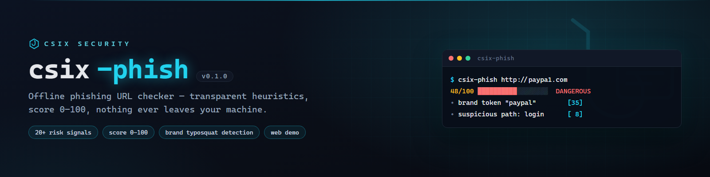

# csix-phish



**Pemeriksa URL phishing offline — heuristik transparan, tanpa jaringan.**

> English documentation: [README.md](README.md)

## Apa ini?

`csix-phish` menilai risiko sebuah URL (skor 0–100) berdasarkan heuristik
yang bisa dijelaskan: typo-squatting merek, subdomain menipu, TLD berisiko,
URL shortener, host ber-IP, dll. Setiap temuan disertai **alasan + bobot**,
bukan black box. **100% offline** — URL tidak pernah dikirim ke server.

## Instalasi & Pakai

```sh
go install github.com/siedysoes/csix-phish@latest

csix-phish http://paypa1-secure.com/login
csix-phish --json https://google.com
```

**Exit code:** `0` aman · `1` ada URL berbahaya · `2` error

## Web Demo (GitHub Pages)

Folder `docs/` berisi versi web yang berjalan 100% di browser (tanpa server).
Aktifkan: **Settings → Pages → Deploy from a branch → main → /docs**.

## Checklist Sebelum Push ke GitHub

1. Ganti `siedysoes` di `go.mod`, `main.go`, `docs/index.html`, dan README
   dengan username GitHub Anda (jika berbeda).
2. Buat repo baru `csix-phish`, push folder ini.
3. Aktifkan **Actions** dan **Pages** (folder `/docs`).

## Lisensi

MIT. Untuk tujuan defensif.
