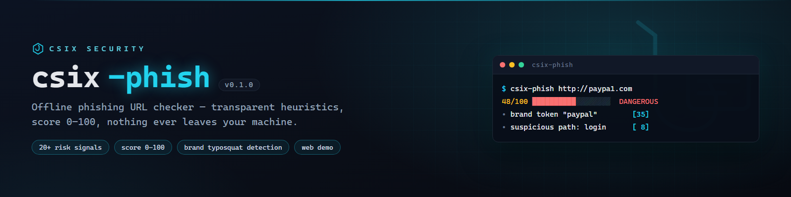

# csix-phish



**Pemeriksa URL phishing offline — heuristik transparan, tanpa jaringan, murni Go.**

[](https://github.com/siedysoes/csix-phish/actions/workflows/ci.yml)
[](LICENSE)

`csix-phish` menilai risiko sebuah URL berdasarkan heuristik yang bisa
dijelaskan: typo-squatting merek, subdomain menipu, TLD berisiko, URL
shortener, host ber-IP, dan puluhan sinyal lain — lalu memberi **skor 0–100**
beserta **alasan setiap temuan** (bukan black box).

> **100% offline** — URL tidak pernah dikirim ke server mana pun.

## Fitur

- 🎯 **Skor 0–100** + level: `LOW` / `SUSPICIOUS` / `DANGEROUS` / `CRITICAL`
- 🔎 **20+ sinyal heuristik** dengan bobot yang bisa diaudit
- 🏷️ Deteksi **typosquatting merek** (paypa1, g00gle, secure-paypal-login...)
  termasuk merek Indonesia (BCA, Gojek, Tokopedia, Shopee, OVO, Dana...)
- 🖥️ **Web demo 100% client-side** — jalankan langsung di GitHub Pages tanpa server
- 📦 `--json` untuk integrasi tooling
- ⚡ Single binary, nol dependency, tanpa koneksi jaringan

## Instalasi

```sh
go install github.com/siedysoes/csix-phish@latest
```

## Penggunaan

```sh
csix-phish http://paypa1-secure.com/login
csix-phish --json https://bit.ly/3xYzAb https://google.com
```

Contoh output:

```
▸ http://paypa1-secure.com/login
  Host     paypa1-secure.com
  Skor     48/100  █████████░░░░░░░░░░░  DANGEROUS

  Sinyal risiko:
   • [ 5] Skema bukan HTTPS — lalu lintas tidak terenkripsi
   • [ 8] Kata kunci mencurigakan: login
   • [35] Domain mengandung merek "paypal"
```

## Opsi

| Flag | Fungsi |
|------|--------|
| `--json` | Output JSON |
| `--threshold <n>` | Skor minimal yang dianggap berbahaya (default 40 → exit 1) |
| `--no-color` | Matikan warna (juga menghormati `NO_COLOR`) |
| `--version` | Tampilkan versi |

**Exit code:** `0` aman · `1` ada URL berbahaya · `2` error

## Web Demo

Halaman statis di folder [`docs/`](docs/) memakai heuristik yang sama
(port JavaScript) dan berjalan sepenuhnya di browser. Untuk mengaktifkannya:

1. Buka **Settings → Pages** di repo ini
2. Pilih *Deploy from a branch* → `main` → folder `/docs`
3. Demo langsung aktif di `https://siedysoes.github.io/csix-phish/`

## Cara Kerja (transparan)

Setiap sinyal punya bobot tetap, totalnya di-clamp ke 100:

| Sinyal | Bobot |
|--------|-------|
| Typosquat merek (paypa1, g00gle) | 40 |
| Merek di subdomain (paypal.com.evil.net) | 35 |
| Host IP mentah | 35 |
| Kredensial di URL (user:pass@) | 30 |
| Punycode / angka desimal | 30 |
| Kata kunci mencurigakan (maks 24) | 8/klaster |
| URL shortener | 20 |
| TLD berisiko (.zip, .tk, .xyz...) | 15 |
| dst. — lihat [`internal/phish/phish.go`](internal/phish/phish.go) | |

**Level:** `LOW` 0–14 · `SUSPICIOUS` 15–39 · `DANGEROUS` 40–69 · `CRITICAL` 70+

Heuristik = indikasi, bukan vonis akhir. Selalu verifikasi manual.

## Dukungan Bahasa

- English (this file)
- [Bahasa Indonesia](README.id.md)

## Lisensi

MIT — lihat [LICENSE](LICENSE). Untuk tujuan defensif.
